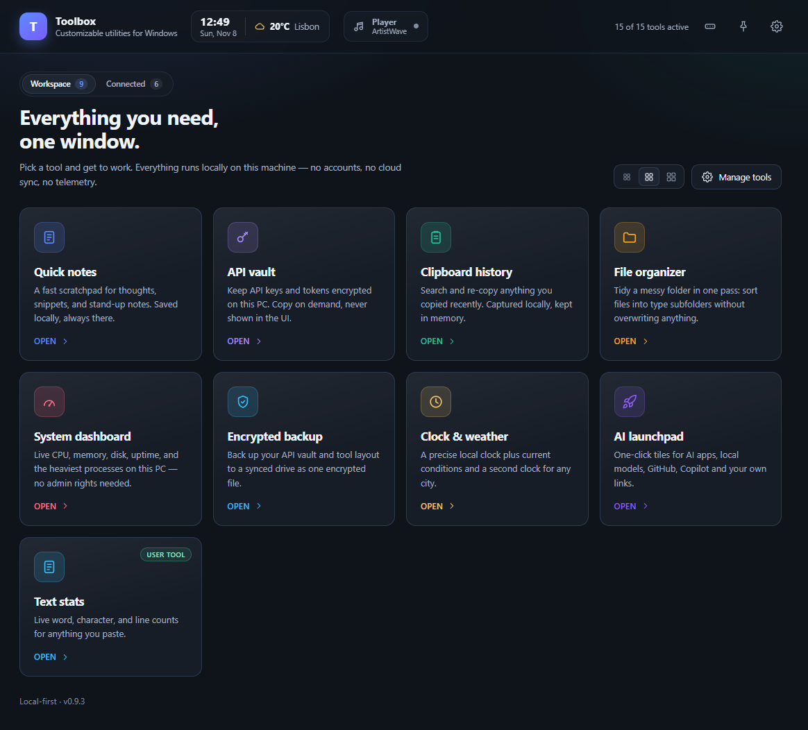
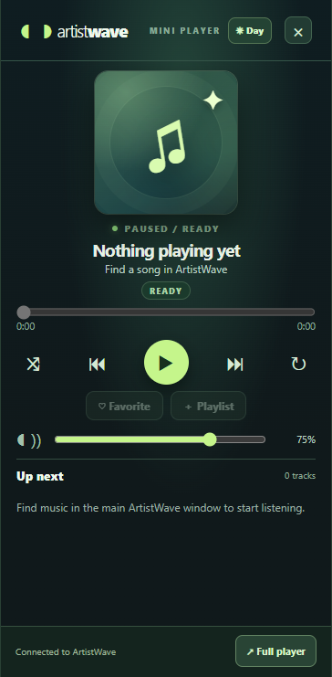
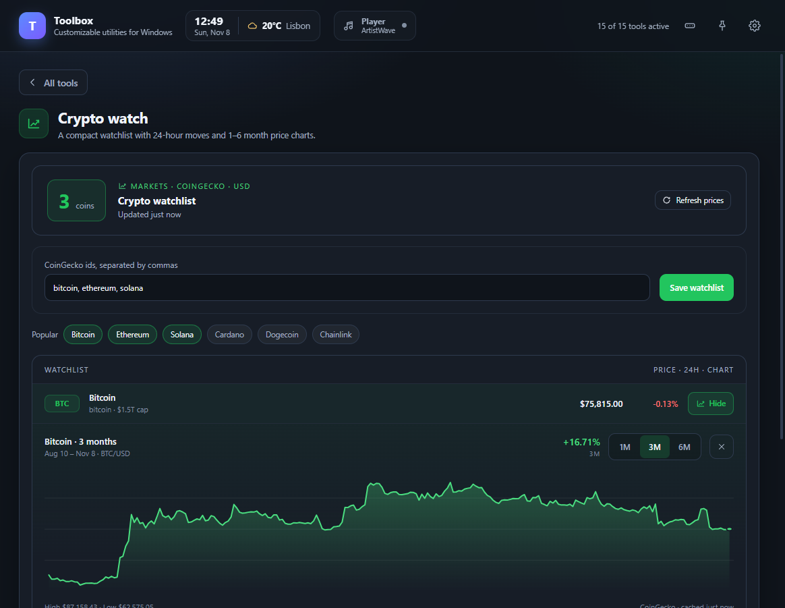
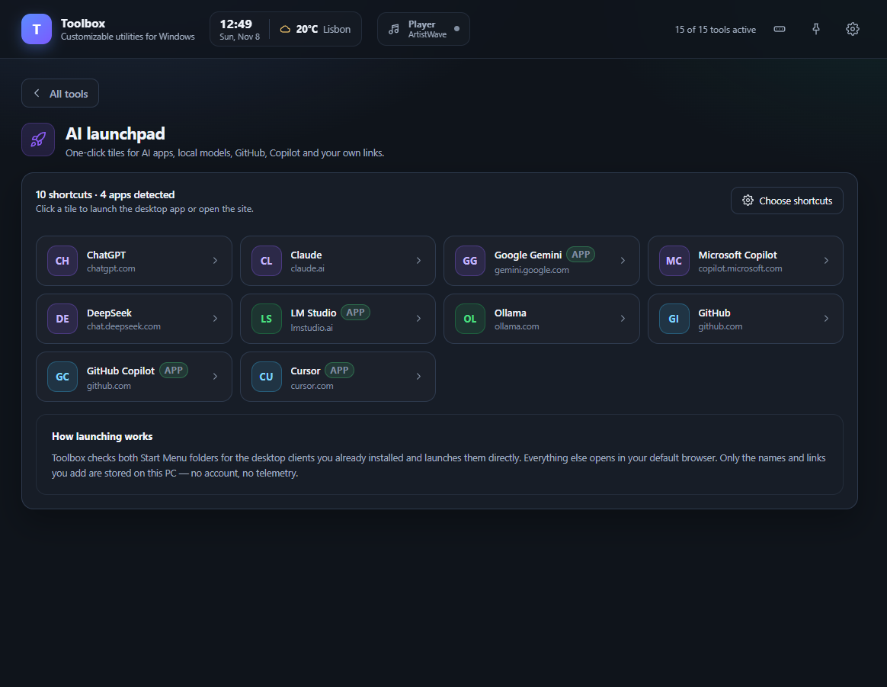

# Toolbox

A local-first Windows toolbox in a single window. Notes, API keys, clipboard history, system stats, feeds, AI app shortcuts, backups and a few distractions — your files stay on this PC, with no Toolbox account or cloud sync. Connected features contact the services you choose to use.



## Highlights

- **Local-first.** Notes, keys, clipboard history and settings stay on this PC. Connected tools send the requests needed to the services you choose; Toolbox does not sync your files to its own cloud.
- **Encrypted secrets.** API keys and tokens in the vault, the GitHub token and the Gmail app password are encrypted with Windows `safeStorage` (DPAPI). Vault values are never shown again after saving unless you explicitly copy them.
- **Encrypted backup.** Export the vault and tool layout as a single AES-256-GCM file, protected by a passphrase you choose.
- **Built-in update checker.** Point it at a GitHub repository or an HTTPS JSON manifest; it checks at startup and on demand, then opens the download page in your browser. Nothing installs silently.
- **Crypto charts.** Watch up to eight coins and open 1, 3 or 6 months of price history, cached for 30 minutes.
- **AI launchpad.** One-click tiles for ChatGPT, Claude, Gemini, Copilot, DeepSeek, GitHub and local model apps. Toolbox finds installed desktop clients in your Start Menu and opens the website otherwise; pick which presets you want and add your own links.
- **ArtistWave mini mode.** The embedded player's own mini-player button narrows Toolbox into a compact now-playing window instead of opening a browser popup.
- **User tools.** Drop a folder with `manifest.json` and `index.js` into the tools directory to add your own local tool.

## Tools

| Workspace | Connected |
| --- | --- |
| Quick notes | Gmail announcer |
| API vault | GitHub notifier |
| Clipboard history | RSS reader |
| File organizer | Crypto watch |
| System dashboard | ArtistWave player |
| Encrypted backup | Bartender Aid |
| Clock & weather | |
| AI launchpad | |
| Text stats | |

Plus a compact mini bar, adjustable dashboard card sizes, and a persistent header clock with weather for any city.

### ArtistWave mini mode

The embedding page's own **Mini player** button narrows Toolbox to the compact now-playing window below. Closing it returns Toolbox to its normal size.



### Crypto charts

Open a chart on any watchlist row for 1, 3 or 6 months of price history. Charts are cached for 30 minutes and request only the selected CoinGecko id.



### AI launchpad

Every preset — AI assistants, local model apps and developer tools such as GitHub and GitHub Copilot — is listed out of the box, but only the ones you pick show up as tiles. Toolbox scans your Start Menu shortcuts and launches an installed desktop client directly; anything else opens in your default browser. Custom links accept `http://` and `https://` only, including `http://localhost` for a local UI.



## Download

Grab the latest Windows x64 build from [Releases](https://github.com/acsdd/toolbox-desktop/releases/latest):

- `Toolbox-Setup-<version>.exe` — per-user installer, no admin rights required.
- `Toolbox-Portable-<version>.exe` — single-file portable build.

The installers are not code-signed yet, so Windows SmartScreen may show a warning until a signing certificate is added. Builds are produced by the release workflow from the tagged source.

## Updates

Open **Manage tools → App updates** and enter a release source:

- `owner/repo` for a public GitHub repository, e.g. `acsdd/toolbox-desktop`
- a GitHub repository URL
- an HTTPS URL to a JSON manifest:

```json
{
  "version": "1.2.3",
  "url": "https://example.com/downloads/toolbox-1.2.3.exe",
  "notes": "What changed in this version.",
  "publishedAt": "2026-11-08T10:00:00Z"
}
```

The check runs silently at startup and whenever you press **Check now**. When a newer version exists, an **Update** pill appears in the header; the details page links to the download. Only public HTTPS hosts are accepted, and the app never downloads or installs anything itself.

## Development

Requires Node.js 22+ and npm.

```bash
npm ci
npm run dev          # electron-vite dev server
npm run typecheck    # main, preload and renderer
npm run smoke        # build + headless Electron acceptance test
npm run screenshots  # build + regenerate .screenshots/
npm run dist         # build + package Windows installers into dist/
```

The release workflow runs `typecheck`, `build` and `electron-builder` on every `v*` tag, then publishes the artifacts to a GitHub Release.

## Project layout

```
src/main/       Electron main process: services, storage, IPC handlers
src/preload/    contextBridge API exposed to the renderer
src/renderer/   React UI, tools and styles
src/shared/     Shared TypeScript types
scripts/        Smoke test and screenshot harnesses
build/          Packaging icon and build resources
website/        Static landing page (no build step)
docs/           Screenshots and publicity planning
.github/        Release and Pages workflows
```

Security boundaries: `contextIsolation` is enabled, `nodeIntegration` is disabled, and remote content is kept out of the Node context. Network access, file access and secret handling all live in the main process behind narrow IPC methods.

## Website

The static landing page in `website/` has no build step, framework or external assets. Preview it from the repository root:

```bash
python -m http.server 8080 --directory website
```

Then open <http://localhost:8080>. Deployment notes, the GitHub Pages workflow and the launch checklist live in [`website/README.md`](website/README.md).

## Privacy notes

- No telemetry, analytics or crash reporting.
- Feed and update URLs reject loopback and private network addresses.
- Gmail access is read-only IMAP using an app password stored encrypted on this machine.
- The GitHub token is encrypted with `safeStorage` and never returned to the renderer.
- The ArtistWave player loads its page from GitHub Pages; it receives no vault data.
- The AI launchpad stores only preset ids and the custom names/links you add; it scans Start Menu shortcut names locally and opens links through the system browser.
- Update checks use HTTPS and include the app version in the user agent; the release provider receives normal connection details such as your IP address.

## License

MIT — see [LICENSE](LICENSE).
