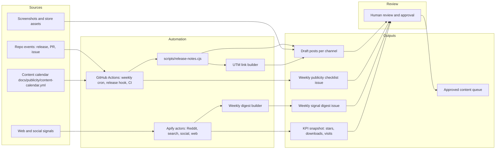

# Publicity automation plan

Goal 1, item 4: automations for publicity and the website plan, with diagram.
Applies to **Toolbox** (Windows desktop, GitHub-hosted) and **Bartender Aid** (React Native + Node backend).

Principles:

- Automation drafts, humans publish. Nothing posts to a public channel without an explicit approval step.
- Zero or near-zero cost first; every paid dependency must be justified in `vendor-assessment.md`.
- Every campaign link carries a UTM tag so results are attributable.
- Secrets live in GitHub Actions secrets or the local vault. Never in the repo.

## Architecture



## Workstream A - content production

- Source of truth: `docs/publicity/content-calendar.yml` (week, channel, product, angle, asset, status, owner).
- `scripts/release-notes.cjs` (built by the PM automation workstream) turns a git tag range into a categorized announcement draft.
- Channel-specific drafts are generated from the same release facts: Product Hunt blurb, Show HN title and body, Reddit post, dev.to article outline, LinkedIn post, short-video script.
- Every draft gets a UTM link:

```text
https://<site>/?utm_source=<channel>&utm_medium=<format>&utm_campaign=<launch-or-update>&utm_content=<variant>
```

Human gate: move draft from `draft` to `approved` in the calendar before publishing. Automated posting is out of scope until the vendor assessment approves a scheduler.

## Workstream B - listening and campaign intelligence (Apify)

Low-frequency, scheduled scrapes feed a weekly digest. Each run writes a dataset item batch and the digest builder deduplicates by URL.

| Signal | Actor | Schedule | Input sketch | Output |
| --- | --- | --- | --- | --- |
| Reddit mentions and relevant threads | `apify/reddit-scraper` | 2x per week | subreddits r/selfhosted, r/windows, r/software, r/SideProject; queries Toolbox, Bartender Aid, local-first toolbox | threads worth replying to, sentiment |
| Search visibility | `apify/google-search-scraper` | weekly | queries for app name, category keywords, competitor alternatives | ranking and new mentions |
| Launch directory coverage | `apify/website-content-crawler` | weekly | AlternativeTo, Softpedia, FossHub category pages | whether the app is listed, competitor gaps |
| Short-video and social trends | `apify/tiktok-scraper`, `apify/instagram-scraper`, `apify/youtube-scraper` | weekly | hashtags: localfirst, windowstools, productivity, bartending | formats and hooks that perform |
| Competitor positioning | `apify/website-content-crawler` | monthly | 5-10 competing toolbox apps | feature and pricing comparison |

Notes:

- Keep runs small: 50-100 items per query. Free-tier credits cover this at low volume; confirm the current plan in the vendor assessment before scaling.
- Store the Apify token as `APIFY_TOKEN` in GitHub Actions secrets and as a vault item locally.
- Digest format: top 5 opportunities, top 3 risks, actions for the week, links to raw dataset runs.

## Workstream C - website automation

- Deploy the static draft in `website/` through GitHub Pages from `main` (workflow owned by the website workstream).
- Link check on every deploy; fail the job on broken links.
- Optional Lighthouse CI budget: performance and accessibility >= 90.
- The site reads release links from GitHub Releases; no hard-coded version numbers.
- Analytics: vendor decision pending in `vendor-assessment.md`. Prefer a cookie-free option (GoatCounter, Umami, Cloudflare Web Analytics).
- Add `robots.txt`, `sitemap.xml`, Open Graph and Twitter card images, and a canonical URL once the domain is chosen.

## Workstream D - PM glue

- Issue templates, PR template, CI, stale policy and one idempotent weekly publicity checklist issue (PM automation workstream).
- The weekly checklist issue is the human entry point: content calendar status, approvals, KPI review, next week's channel.
- Coverage target: at least 70% of recurring PM steps automated. Remaining manual steps: channel-specific final copy review, community replies, store console uploads, spend approval.

## Workstream E - KPI snapshot

Weekly automated snapshot, posted into the digest issue:

- GitHub: stars, forks, release download counts (Releases API `assets[].download_count`).
- Website: visits and top sources from the chosen analytics API.
- Mobile: Play Console internal-test installs and crashes (manual export until an API path is approved).
- Conversion: download page visits to installer downloads, site to GitHub click-through.

## Weekly operating rhythm

| When | Automated | Human |
| --- | --- | --- |
| Daily | Uptime check, link check on deploy | - |
| 2x per week | Reddit signal scrape | Reply where genuinely useful |
| Weekly | Search, directory and social scrapes; KPI snapshot; checklist issue | 30-minute review, approve next week's posts |
| On tag | Build, release, categorized release notes, draft announcement | Final copy and channel scheduling |
| Monthly | Competitor crawl, vendor and cost review | Decide keep, switch or drop vendors |

## Implementation order

1. Week 1: PM automation and release notes; content calendar; website draft online.
2. Week 1: advertise on GitHub topics and publish the first release note; capture baseline KPIs.
3. Week 2: Apify listening digest (Reddit and search first); UTM builder.
4. Week 3: first launch sequence (Product Hunt plus Show HN) with approved drafts; website analytics live.
5. Week 4: review results, keep the two best channels, cut the rest, set the monthly cadence.

## Required secrets and approvals

- `APIFY_TOKEN` (GitHub Actions secret, plus local vault entry).
- `GITHUB_TOKEN` (built in; `contents: write`, `issues: write` already used by workflows).
- Analytics API token (after vendor decision).
- Human approval before any public post, paid promotion or store submission.
